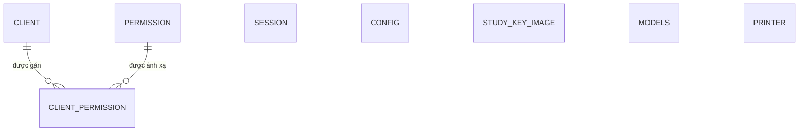

# Entity Model

## Entity Relationship Diagram

### SESSION

Một phiên truy cập Viewer gắn các study với kho DICOM, thời hạn và quyền hiệu lực.

| Attribute | Description | Data Type | Length/Precision | Validation Rules |
|-----------|-------------|-----------|------------------|------------------|
| id | Định danh duy nhất của phiên | String | 64 | Primary Key |
| store_url | Địa chỉ kho DICOM của phiên | String | - | Optional |
| store_auth | Thông tin xác thực chuyển tiếp tới kho DICOM | String | - | Optional |
| studies | Danh sách study thuộc phiên | String | - | Not Null |
| user_id | Định danh người dùng bên hệ thống gọi | String | 32 | Optional |
| anonymized | Cho biết phiên dùng dữ liệu ẩn danh | Boolean | 1 | Not Null |
| shared_session | Cho biết đây là phiên chia sẻ | Boolean | 1 | Not Null |
| share_key | Khóa truy cập bổ sung của phiên chia sẻ | String | 16 | Optional |
| expired_time | Thời điểm phiên hết hạn | DateTime | - | Not Null |
| permissions | Các quyền được đóng gói trong phiên | String | - | Optional |

### CONFIG

Một giá trị cấu hình có tên được Viewer sử dụng khi vận hành.

| Attribute | Description | Data Type | Length/Precision | Validation Rules |
|-----------|-------------|-----------|------------------|------------------|
| id | Khóa cấu hình | String | 64 | Primary Key |
| value | Giá trị cấu hình | String | - | Not Null |
| description | Mô tả mục đích cấu hình | String | - | Optional |
| datatype | Kiểu logic của giá trị cấu hình | String | 32 | Optional |

### CLIENT

Một hệ thống client được phép yêu cầu tạo phiên Viewer.

| Attribute | Description | Data Type | Length/Precision | Validation Rules |
|-----------|-------------|-----------|------------------|------------------|
| id | Định danh client | String | 64 | Primary Key |
| password | Bí mật xác thực đã lưu của client | String | 64 | Not Null |
| ip_allowed | Danh sách địa chỉ mạng được phép | String | - | Optional |

### PERMISSION

Một quyền chức năng có thể được gán cho client và đưa vào phiên.

| Attribute | Description | Data Type | Length/Precision | Validation Rules |
|-----------|-------------|-----------|------------------|------------------|
| id | Định danh quyền | String | 64 | Primary Key |
| name | Tên hiển thị duy nhất của quyền | String | 64 | Not Null, Unique |
| description | Mô tả phạm vi quyền | String | - | Optional |

### CLIENT_PERMISSION

Ánh xạ nhiều-nhiều giữa client và quyền.

| Attribute | Description | Data Type | Length/Precision | Validation Rules |
|-----------|-------------|-----------|------------------|------------------|
| client_id | Client nhận quyền | String | 64 | Primary Key, Foreign Key (CLIENT.id) |
| permission_id | Quyền được gán | String | 64 | Primary Key, Foreign Key (PERMISSION.id) |

#### Constraints

- Primary Key: (client_id, permission_id)

### STUDY_KEY_IMAGE

Một lô key image đang chờ được gửi tới kho DICOM hoặc chờ xử lý lại.

| Attribute | Description | Data Type | Length/Precision | Validation Rules |
|-----------|-------------|-----------|------------------|------------------|
| id | Study Instance UID định danh bản ghi key image của study | String | - | Primary Key |
| series_iuid | Series Instance UID của lô | String | 64 | Not Null |
| num_of_image | Số ảnh trong lô | Integer | 10 | Not Null |
| store_url | Địa chỉ kho DICOM đích | String | - | Not Null |
| store_auth | Thông tin xác thực chuyển tiếp | String | - | Optional |
| succeed | Cờ chọn bản ghi chưa gửi thành công; bản ghi được xóa khi gửi thành công | Boolean | 1 | Not Null |
| num_of_retry | Bộ đếm lần thử gửi; cơ sở dữ liệu mặc định là 0, luồng tiếp nhận key image đặt thành 1 khi ghi nhận hoặc cập nhật lô | Integer | 10 | Not Null |
| description | Mô tả lỗi gần nhất | String | - | Optional |
| created_time | Thời điểm tạo bản ghi | DateTime | - | Not Null |
| creator_id | Định danh tác nhân tạo | Integer | 10 | Not Null |
| last_updated_time | Thời điểm cập nhật gần nhất | DateTime | - | Optional |
| last_updated_id | Định danh tác nhân cập nhật | Integer | 10 | Optional |

### MODELS

Một model AI được đăng ký để định tuyến yêu cầu suy luận.

| Attribute | Description | Data Type | Length/Precision | Validation Rules |
|-----------|-------------|-----------|------------------|------------------|
| id | Định danh model | Integer | 10 | Primary Key, Sequence |
| model_name | Tên duy nhất dùng để chọn model | String | 255 | Not Null, Unique |
| url | Địa chỉ dịch vụ model | String | - | Not Null |
| authentication | Thông tin xác thực dịch vụ model | String | - | Optional |
| config_json | Cấu hình mở rộng của model | String | - | Optional |
| created_time | Thời điểm tạo bản ghi | DateTime | - | Not Null |
| creator_id | Định danh tác nhân tạo | Integer | 10 | Not Null |
| last_updated_time | Thời điểm cập nhật gần nhất | DateTime | - | Optional |
| last_updated_id | Định danh tác nhân cập nhật | Integer | 10 | Optional |

### PRINTER

Một máy in DICOM có thể nhận tác vụ in từ Viewer.

| Attribute | Description | Data Type | Length/Precision | Validation Rules |
|-----------|-------------|-----------|------------------|------------------|
| id | Định danh máy in | Integer | 10 | Primary Key, Sequence |
| printer_name | Tên máy in | String | 255 | Not Null |
| host | Máy chủ của máy in | String | 255 | Not Null |
| port | Cổng kết nối máy in | Integer | 10 | Not Null, Min: 1, Max: 65535 |
| aetitle | AE Title phía gửi | String | 255 | Not Null |
| called_aetitle | AE Title phía máy in | String | 255 | Not Null |
| description | Mô tả máy in | String | - | Optional |
| enabled | Cho biết máy in có thể được sử dụng | Boolean | 1 | Not Null |
| created_time | Thời điểm tạo bản ghi | DateTime | - | Not Null |
| creator_id | Định danh tác nhân tạo | Integer | 10 | Not Null |
| last_updated_time | Thời điểm cập nhật gần nhất | DateTime | - | Optional |
| last_updated_id | Định danh tác nhân cập nhật | Integer | 10 | Optional |
